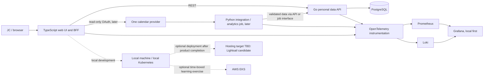

# JC's Dashboard — Project Plan

**Status:** Planning draft  
**Last updated:** 2026-11-18  
**Owner:** JC  
**Purpose:** A personal dashboard and a deliberately staged, hands-on learning project spanning several languages and cloud-native tools.

> This document is the initial source of truth for goals, decisions, scope, architecture, and delivery. Items marked **TBD** are open decisions, not assumed requirements. Revisit this plan at each milestone rather than building every future capability up front.

## 1. Vision

Build a private, responsive personal dashboard that brings together a small number of useful personal workflows—tasks and habits, calendar events, learning/reading progress, and manually recorded financial summaries. Use it as a practical way to learn TypeScript, Go, Python, AWS, Kubernetes, infrastructure as code, CI/CD, security, and observability.

The project should remain useful early: start with a working local application and sample data, then add real integrations and short-lived AWS/Kubernetes deployments only after the core experience and security controls are in place.

## 2. Goals and learning outcomes

- Deliver an authenticated dashboard with a coherent, responsive UI and a small set of working features.
- Practice **TypeScript** for the web experience, **Go** for a typed HTTP API, and **Python** for analytics or asynchronous data jobs.
- Learn REST API design, API contracts, persistence, integration boundaries, and graceful degradation.
- Use **PostgreSQL** as the initial system of record; introduce other storage or messaging only when a concrete use case justifies it.
- Build and validate the complete application locally before choosing a hosting target. Keep Kubernetes as a local learning track; consider EKS only for an explicitly time-boxed AWS learning exercise, not as the assumed production host.
- Practice Terraform/OpenTofu, GitHub Actions, container builds, deployment automation, and rollback/teardown procedures.
- Establish useful observability with OpenTelemetry-compatible instrumentation and a local Grafana, Prometheus, and Loki stack. If/when deployed, evaluate running the observability stack alongside the application on the selected host, with capacity and failure-mode tradeoffs documented.
- Treat authentication, least privilege, secret handling, privacy, testing, backups, and cost control as design requirements rather than afterthoughts.

## 3. Non-goals for the first release

- A public, multi-user SaaS product or a promise of production availability.
- Automated bank connections, payment initiation, financial advice, or storage of banking credentials. Finance starts with manual entry and CSV import only.
- Supporting every calendar/task provider at once. Start with sample data, then select and integrate one provider before adding another.
- Microservices for every domain, Kafka/MSK, a service mesh, Redis, or a complex event-driven platform without a demonstrated need.
- Always-on EKS or a continuously running cloud observability stack under the current **under $50/month** target.
- Storing production personal data in development/test environments.

## 4. Users and MVP experience

**Initial user:** one person (JC). Access is private during development. Public access is not approved by this plan; make an explicit security decision before any internet-facing launch.

### Proposed MVP sequence

1. Sign in to a local development instance and see a combined dashboard populated with synthetic/seed data.
2. Create, edit, complete, and review tasks and habits.
3. View a small learning/reading list and update progress.
4. View calendar events from sample data; add read-only OAuth sync for **one** provider only after the security gate. The provider is TBD (Google or Microsoft).
5. Record a simple manual finance entry or import a documented CSV format and show category/month summaries. No bank credentials or brokerage integration.
6. See each integration's last successful sync time, freshness/stale state, and actionable error status. The dashboard should remain usable when an integration is unavailable.

The first usable milestone should prioritize items 1–3. Calendar OAuth and finance CSV can follow as separate slices rather than blocking a useful first version.

### MVP acceptance criteria

- A user can run the application locally using documented setup steps and synthetic seed data.
- The user can authenticate in the local development setup and perform the agreed task/habit and learning-list flows.
- The UI works on mobile and desktop, supports keyboard navigation for primary flows, and has a basic light/dark theme.
- API behavior is documented and contract-tested; critical domain flows have unit and integration coverage, with an end-to-end smoke test for sign-in and a core dashboard action.
- No secrets or personal data are committed to Git. Test data is synthetic.
- The application gives a useful response when an optional data source is missing or stale.
- A local observability profile can show service health and request/error metrics; the setup is optional for everyday development.
- AWS deployment is not required for the first usable release.

## 5. Proposed architecture

### Logical view



This is a proposed logical design, not a requirement to deploy every box in the first milestone. Keep synchronous product operations simple. The Python job can initially run as a scheduled/local command; add a queue only if retries, workload isolation, or asynchronous processing become real requirements.

### Language and responsibility proposal

| Component                                  | Language                 | Initial responsibility                                                                      | Timing                                          |
| ------------------------------------------ | ------------------------ | ------------------------------------------------------------------------------------------- | ----------------------------------------------- |
| Web UI and thin backend-for-frontend (BFF) | TypeScript               | Responsive dashboard, session-aware UI, aggregate calls to the API                          | MVP                                             |
| Personal data API                          | Go                       | REST API, domain validation, authorization checks, PostgreSQL access                        | MVP                                             |
| Integration/analytics job                  | Python                   | Import validation, sync/aggregation experiments, later analytics                            | After core MVP; start as a separate process/job |
| Domain-specific services                   | Go/Python as appropriate | Split only where an independent deployment or scaling/security boundary has a clear benefit | Future decision                                 |

**Boundary rule:** use separate codebases or deployables where they create a real learning or operational benefit, but do not split tasks, finance, calendar, and learning into four network services immediately. Start with a small number of components and explicit module/API boundaries. The recommended starting point is one GitHub monorepo, reassessed after the first vertical slice.

### API and data flow

- REST over HTTPS at service boundaries; specify OpenAPI contracts and version deliberately.
- The browser should call the BFF or a single well-defined API origin rather than learning internal service topology.
- The Go API owns authoritative domain writes and PostgreSQL transactions.
- Integration jobs validate and normalize external data; credentials are scoped read-only and never exposed to the browser or logs.
- Track integration freshness and sync errors as first-class status, without logging sensitive payloads.
- Define idempotency/retry behavior before scheduling recurring syncs.

### Initial data domains (candidate)

- **Tasks/habits:** user-owned records, completion history, timestamps, optional recurrence rules.
- **Calendar:** normalized read-only event view plus provider/source IDs and sync metadata; avoid copying unnecessary event details.
- **Learning/reading:** item title, source/type, status, progress, and optional notes.
- **Finance:** manual or CSV-imported transactions and categories, with import provenance; establish retention and deletion rules before using real data.
- **Operations:** integration connection metadata, last sync result/time, and a minimal audit trail for sensitive actions.

The schema is not finalized. Define ownership, timezone behavior, recurrence semantics, deduplication, deletion, and CSV validation rules before implementing the relevant domain.

## 6. Technology decisions and open choices

| Area                       | Current direction                          | Decision state / notes                                                                                               |
| -------------------------- | ------------------------------------------ | -------------------------------------------------------------------------------------------------------------------- |
| Frontend                   | TypeScript                                 | Framework TBD; choose based on desired learning and accessibility support.                                           |
| Backend                    | Go REST API                                | Framework TBD; keep HTTP behavior and OpenAPI contracts portable.                                                    |
| Analytics/integration jobs | Python                                     | Add after MVP; avoid a separate always-on worker until needed.                                                       |
| Primary database           | PostgreSQL                                 | Local first. Cloud database choice and cost implications need a separate decision.                                   |
| Cache                      | None initially                             | Add Redis only after profiling identifies a need.                                                                    |
| Messaging                  | None initially                             | Consider SQS/EventBridge if a real asynchronous/retry use case emerges; avoid Kafka/MSK initially.                   |
| Containers/orchestration   | Containers and local Kubernetes            | Learn locally; EKS is optional and time-boxed, not the assumed deployment target.                                    |
| Hosting                    | Undecided; AWS Lightsail candidate         | Revisit after local completion; compare total cost including hosted observability.                                   |
| Low-cost always-on hosting | Raspberry Pi Zero 2 W candidate            | Optional private app host; too constrained for the full app plus observability stack.                                |
| Infrastructure as code     | Terraform/OpenTofu                         | Select one and pin versions; decide state storage/locking before shared or cloud use.                                |
| CI/CD                      | GitHub Actions                             | Test/build on pull request; deployment on main only after protections and environment controls.                      |
| Identity                   | OIDC; Amazon Cognito proposed for AWS      | Local development identity approach TBD. Never put provider secrets in frontend bundles.                             |
| Secrets                    | AWS Secrets Manager for cloud credentials  | Local secrets via ignored local configuration/secret store; never commit secrets.                                    |
| Observability              | OpenTelemetry; Grafana + Prometheus + Loki | Develop and test locally; if deployed, prefer co-location on chosen host initially, subject to resource/cost review. |
| Region                     | One region near the owner                  | Exact AWS region TBD; consider latency, availability, and service pricing.                                           |
| Repositories               | One GitHub monorepo initially              | Keep app, contracts, docs, and early infrastructure together; split only when useful.                                |

## 7. AWS, Kubernetes, and cost strategy

### Budget constraint

Target cloud spend is **under $50/month**. No hosting provider or deployment platform is selected yet. EKS is not the default: a continuously running cluster can exceed this budget before application workloads and observability are included. Revisit deployment only after the product and local operational stack are working; compare complete costs rather than compute alone.

### Staged deployment approach

1. **Local product development:** build and run the complete application, PostgreSQL, and observability stack locally with synthetic data. Ensure the project remains useful and testable without AWS.
2. **Local operations learning:** containerize the full stack and practice Kubernetes locally if the development machine can support it. Kubernetes is a learning environment, not a deployment decision.
3. **Hosting decision after completion:** compare private Pi hosting, AWS Lightsail, and other suitable options against actual measured CPU/RAM/storage needs and the desired availability/access model. No cloud resources are required during feature development.
4. **Lightsail candidate:** if AWS is selected, evaluate one appropriately sized Lightsail instance hosting the application, database, and Grafana/Prometheus/Loki stack. Do not assume the previously discussed 2 GB instance is sufficient once monitoring is included; benchmark the complete stack and estimate storage, backups, bandwidth, and any domain costs. A single host is a learning/low-cost setup, not highly available, and monitoring on the same host cannot report if that host itself is down.
5. **Optional EKS exercise:** if EKS learning remains a goal, provision a small isolated cluster only for a planned, time-boxed exercise, then remove it and verify teardown and billing. Do not deploy the long-running product to EKS by default.
6. **Pi evaluation:** test the Raspberry Pi Zero 2 W as a private low-traffic app host if useful, but do not plan to run the full app, database, and observability stack together on its 512 MB RAM. Compare electricity, home-network access, reliability, backups, and maintenance with cloud options.

### Cost guardrails

- Set an AWS budget and billing notifications before provisioning; alerts are not hard spending caps.
- Estimate the full environment (cluster/control plane, compute, load balancer, database/storage, NAT/network, logs/metrics, backups, and data transfer) before each experiment.
- Tag resources and define a maximum experiment duration and owner for every environment.
- Use automation and a human-readable teardown checklist; confirm resources are actually removed.
- Keep the full Grafana/Prometheus/Loki stack local during development. For a later Lightsail deployment, price and benchmark monitoring storage/retention and required instance size as part of the same bill; do not assume the app-only estimate includes observability.
- Avoid NAT gateways, always-on managed databases, and idle compute unless a reviewed estimate justifies them.
- For a Pi, estimate electricity from measured wall power using `annual kWh = watts × 8.76`; multiply by the local electricity rate. This excludes internet/network costs that may already be sunk costs. Measure the actual board, power supply, and any storage/peripherals rather than relying on a nominal estimate.
- **TBD:** final hosting platform, exact monthly cap and experiment limit, and whether Lightsail can fit the app plus database and observability stack within the cap.

### Raspberry Pi Zero 2 W assessment

The Pi Zero 2 W may be a good **low-cost, always-on home host** for a personal, low-traffic dashboard, but it is not a drop-in replacement for AWS/EKS or a general-purpose home server. Its 512 MB RAM, Wi-Fi-only connectivity, and microSD-based storage make it appropriate for a small ARM64-compatible app/API and perhaps a carefully measured database, but leave little headroom for PostgreSQL, builds, and monitoring together. Build images in GitHub Actions rather than on the Pi; verify every container image supports ARM64. Keep Grafana/Prometheus/Loki and Kubernetes practice on a development machine or local cluster with more resources.

Before relying on it, measure memory and disk usage under load; use a reliable power supply and storage; configure automated, tested backups to another device/location; and plan for SD-card failure, power/network outages, updates, and recovery. Do not expose it directly to the public internet as the default. Prefer private LAN or VPN/zero-trust access, and confirm whether the home ISP/router allows inbound access (including CGNAT considerations) before designing remote reachability. If using GitHub Actions later, prefer CI building/publishing a multi-architecture image and an outbound pull/deploy flow from the Pi; avoid exposing an SSH port or using a broadly privileged self-hosted runner without a separate security review.

**Provisional recommendation:** use the Pi as an optional private hosting experiment after the application works locally. It likely reduces incremental cloud/compute costs for an always-on, low-traffic service, but trades away availability and adds home-network and maintenance responsibilities. It does not replace the AWS/EKS learning phase.

## 8. Security, privacy, and data lifecycle

- Default to private access. Before any public endpoint, document the threat model, identity flow, exposure, abuse controls, and recovery plan.
- Require authenticated access for personal data. Apply authorization at the API boundary, validate ownership on every record operation, and use least-privilege AWS IAM roles.
- Use TLS in transit and encryption at rest for cloud data stores. Do not put credentials in source, images, browser code, logs, or CI output.
- Store cloud secrets in Secrets Manager with narrowly scoped access; use short-lived identity/role credentials where possible. Define rotation and revocation steps before real OAuth connections.
- Start with synthetic development/test data. Do not move real personal/financial data to AWS until security and backup gates are reviewed.
- Calendar integration should be read-only and request the minimum OAuth scopes. Choose Google or Microsoft first; provider remains TBD.
- Finance MVP uses manual data or CSV only. Validate file type, size, encoding, headers, dates, numeric values, duplicate behavior, and error reporting. Never execute imported content.
- Minimize imported personal content; avoid retaining raw files or full event descriptions without a justified need.
- Define export, deletion, retention, and backup behavior before enabling production-like personal data. Reconcile deletion with backups and provider tokens.
- Maintain a minimal audit trail for security-sensitive actions (login/security events, integration connection/revocation, exports/deletions, privileged changes). Exclude secrets and sensitive payloads.
- Add dependency/container scanning and secret detection to CI. Review third-party packages and image provenance.
- Write a lightweight threat model covering account takeover, exposed endpoints, OAuth token theft, insecure CSV handling, authorization bugs, secret leakage, and unintended AWS spend.

### Security release gate for real data

Do not use real personal data in a cloud environment until authentication/authorization, secret handling, transport/storage encryption, backup/restore, access restrictions, deletion/export expectations, logging redaction, and incident/credential-revocation steps have been exercised and documented.

## 9. Reliability and observability

- Instrument request counts, latency, errors, dependency health, and job/sync outcomes using OpenTelemetry conventions where practical.
- Use structured logs with correlation/request IDs; redact credentials, OAuth tokens, finance details, and unnecessary calendar/task content.
- Grafana dashboards should answer: Is the app available? Which dependency is failing? Are API errors or latency increasing? When did each integration last succeed? Develop and validate these dashboards locally; if the app is deployed, the preferred learning goal is to run the observability stack on that host too, after verifying resource headroom and retention costs.
- Define initial service-level objectives only after observing local behavior; keep them appropriate for a personal project. Candidate measures include successful core API requests and dashboard load latency.
- Alerts should be actionable, low-noise, and include a runbook. Local alerts may be simulated; for a hosted stack, add an external heartbeat/dead-man signal if practical, since monitoring on the same host cannot report that host's outage.
- Keep metrics cardinality bounded; do not use user IDs, transaction IDs, or event titles as metric labels.
- Degrade gracefully on provider/API failure, retain last known good data where safe, show freshness, retry with bounded backoff, and expose a manual refresh where appropriate.
- **TBD:** data freshness targets, backup retention, recovery time objective (RTO), recovery point objective (RPO), and whether alerts need to reach a phone/email.

## 10. Testing and quality plan

- **Unit tests:** domain rules, parsing/validation, authorization helpers, and UI components.
- **Integration tests:** Go API with disposable PostgreSQL; Python import/sync job with provider fixtures; no real user credentials in CI.
- **Contract tests:** validate OpenAPI and compatibility between the UI/BFF and API.
- **End-to-end tests:** core sign-in and dashboard flows using synthetic data; test mobile layout and keyboard access for primary actions.
- **Resilience tests:** provider timeout/rate limit, stale data, duplicate sync, malformed CSV, and database unavailable behavior.
- **Security checks:** dependency and container scanning, secret scanning, authorization tests, and a review of OAuth scopes.
- **Operational checks:** backup restore drill before cloud data, deployment rollback, and teardown verification.
- Keep CI fast for pull requests; run slower integration/security checks in a separate job if necessary. Pin toolchains and dependencies where practical.

## 11. Delivery and repository approach

- **Recommendation: start with one private GitHub monorepo** for this solo learning project. The UI, Go API, OpenAPI contract, and deployment configuration will change together; one pull request and one Actions workflow are easier to maintain than coordinating several repositories. This does not require deploying every component as a microservice.
- Keep production/personal data out of GitHub. Store source, documentation, infrastructure definitions, and synthetic fixtures in the repository; actual dashboard records belong in PostgreSQL. Never commit credentials, OAuth tokens, `.env` files, local database volumes, Terraform state, or kubeconfig files.
- Suggested repository layout (add service-specific directories only when those phases begin):

  ```text
  jc-dashboard/
  ├── .github/
  │   └── workflows/            # CI now; guarded deploy workflow later
  ├── apps/
  │   └── web/                  # TypeScript UI and thin BFF
  ├── services/
  │   ├── api/                  # Go REST API
  │   └── worker-python/        # Add in the integration/analytics phase
  ├── contracts/
  │   └── openapi/              # API contract shared by UI, API, and tests
  ├── deploy/
  │   └── kubernetes/           # Local base/overlays; AWS overlay only when needed
  ├── infra/
  │   └── terraform/            # AWS resources; no state files in Git
  ├── observability/
  │   ├── grafana/              # Provisioning and dashboards
  │   └── local/                # Local Prometheus/Loki configuration
  ├── docs/
  │   ├── adr/                  # Short architecture decision records
  │   ├── runbooks/             # Deploy, restore, incident, and teardown steps
  │   └── architecture/         # Diagrams and supporting design notes
  ├── scripts/                  # Cross-platform helper scripts where practical
  ├── .dockerignore
  ├── .env.example              # Names/placeholders only; no secrets
  ├── .gitignore                # Local data, secrets, build output, IaC state
  ├── compose.yaml              # Optional local app/dependency workflow
  ├── README.md                 # Quick start and development commands
  └── project.md                # This plan
  ```

- Initially, build the web app, Go API, and contract. Do not create placeholder services for every domain. Add `worker-python/` when there is a real integration or analytics task. Keep domain modules inside the API until a split is justified.
- Use one root CI workflow with path-aware jobs where that is helpful. Pull requests should run relevant formatting, lint, test, contract, and build checks. Add AWS deployment only later, using GitHub OIDC, a protected GitHub environment, narrowly scoped IAM permissions, and explicit approval for infrastructure changes.
- Treat local data folders and local volumes as disposable and ignored by Git. Add only synthetic fixtures under a clearly named test/fixture path if needed.
- Split into separate repositories later only if a component needs independent access control, ownership, release cadence, or genuinely independent reuse. A future split could move `infra/` to a dedicated private repository; do not pay that coordination cost up front.
- The repository should document local setup, tests, configuration variables (names only), API responsibilities, and security considerations.
- GitHub Actions should run formatting, linting, tests, contract checks, and image builds on pull requests.
- Protect the default branch. Deployments should use short-lived AWS credentials via GitHub OIDC rather than long-lived access keys.
- Deploy to AWS only from a protected environment, with environment-scoped permissions and an approval step for infrastructure changes. The selected “deploy on merge” preference applies only after these protections are established.
- Use immutable image tags/digests, health checks, and a documented rollback path. Do not automatically destroy or overwrite persistent data during deploys.
- **TBD:** GitOps (Argo CD/Flux) vs GitHub Actions direct deploy, and Helm vs Kustomize. Keep the initial workflow simple and decide these when the deployment phase begins.

## 12. Phased roadmap

Estimates are learning-oriented ranges, not commitments. Adjust based on available time and scope.

| Phase                         | Deliverable                                                                                                    | Learning focus                                               | Exit criteria                                                                                                                           |
| ----------------------------- | -------------------------------------------------------------------------------------------------------------- | ------------------------------------------------------------ | --------------------------------------------------------------------------------------------------------------------------------------- |
| 0. Define and prepare         | Finalize first vertical slice, feature order, repo plan, local tooling, and threat/cost assumptions            | Requirements, architecture decisions, developer workflow     | Open decisions for MVP are resolved or explicitly deferred; setup can be reproduced                                                     |
| 1. Local vertical slice       | TypeScript UI + Go API + PostgreSQL; synthetic data; task/habit and learning list                              | TypeScript, Go, REST, SQL, UI, testing                       | Core flows work end to end; API contract and tests exist; basic responsive/accessibility pass                                           |
| 2. Local platform             | Containerize, run on local Kubernetes, add local Grafana/Prometheus/Loki                                       | Containers, Kubernetes, probes, config, metrics/logs         | Repeatable local deploy; health and error signals visible; teardown/reset documented                                                    |
| 3. Integration slice          | Add one calendar provider in read-only mode; expose freshness/error state                                      | OAuth/OIDC, Python or Go sync, retries, rate limits, privacy | Minimum scopes, token handling, revocation, stale/error behavior tested; real data remains opt-in                                       |
| 4. Finance and analytics      | Add manual/CSV finance flow and a Python analytics job using synthetic data first                              | Python, data validation, analytics, privacy                  | CSV edge cases and duplicate policy tested; no bank linking; outputs explainable                                                        |
| 5. CI/CD and hosting decision | GitHub Actions; evaluate a completed deployment target (Lightsail candidate); optional time-boxed EKS exercise | IaC, CI/CD, host operations, observability, cost controls    | Full app-plus-observability estimate reviewed; deployment/rollback and backup restore tested; any temporary AWS resources are torn down |
| 6. Hardening and portfolio    | Backups/restore, security review, runbooks, architecture/decision records, demo                                | SRE, recovery, technical communication                       | Security gate documented; restore drill and teardown checklist passed; portfolio demo uses non-sensitive data                           |

Do not start a later phase merely because its technology is interesting. Each phase should leave the project in a runnable and explainable state.

## 13. Risks and mitigations

| Risk                                                             | Mitigation                                                                                                                                                                       |
| ---------------------------------------------------------------- | -------------------------------------------------------------------------------------------------------------------------------------------------------------------------------- |
| Scope grows into many services before there is a working product | One vertical slice at a time; split services only for a clear boundary or learning objective; keep a future-work list.                                                           |
| Hosting plus observability exceeds the budget                    | Build everything locally first; benchmark the complete stack; include logs, metrics, retention, backups, and host sizing in the cost estimate; keep EKS optional and time-boxed. |
| Personal data is exposed through a public endpoint or logs       | Private-by-default access, synthetic data until security gate, least privilege, log redaction, threat model and scope review.                                                    |
| OAuth integration becomes provider-specific and fragile          | Start with one provider, minimal read-only scopes, fixtures, token revocation procedure, isolate provider adapters.                                                              |
| Syncs duplicate, omit, or stale data                             | Idempotency/deduplication design, last-success metadata, bounded retries, tests for pagination/rate limits and partial failure.                                                  |
| Python/Go/TypeScript toolchains slow delivery                    | Keep contracts explicit, pin versions, automate common checks, avoid needless cross-language calls.                                                                              |
| Backups exist but cannot be restored                             | Schedule a restore drill and record measured result before relying on cloud persistence.                                                                                         |
| CI deployment has excessive privileges                           | GitHub OIDC, environment-scoped IAM, protected branches, approvals for infrastructure changes, no long-lived keys.                                                               |
| Repository split creates friction                                | Start with a small number of repos and automate shared checks; revisit topology after the first deployed slice.                                                                  |

## 14. Decisions still needed

Resolve these before the relevant implementation phase; they need not all block the initial local slice.

1. **Calendar provider:** Google or Microsoft first? Which account/data is safe to use for development?
2. **Local identity:** What local OIDC/auth setup will mirror Cognito closely enough without unnecessary overhead?
3. **Frontend framework:** Which TypeScript framework best matches the desired learning outcomes?
4. **API framework and schema tooling:** Which Go HTTP/router and OpenAPI generation/validation workflow?
5. **First feature order:** Confirm task/habit and learning list as the initial vertical slice; decide whether calendar or finance follows.
6. **Finance CSV:** Define columns, currency handling, timezone/date rules, duplicate detection, retention, and export/delete needs.
7. **Repository topology:** Start with the recommended single private monorepo; revisit a separate infrastructure repository only if access control or release independence requires it.
8. **Deployment packaging:** Helm or Kustomize; GitHub Actions direct deployment or GitOps.
9. **AWS region:** Select a region and validate service availability/pricing.
10. **AWS budget policy:** Confirm under $50/month remains the target; set an experiment-level ceiling and billing notification recipients.
11. **Cloud data store:** Decide whether to run PostgreSQL on the chosen host or use a managed database; compare cost, backup, maintenance, and recovery implications after local resource usage is measured.
12. **Deployment target:** Build and test locally first; later compare Lightsail (including colocated observability), Pi Zero 2 W, and other options. EKS is an optional temporary learning exercise, not the default hosting target.
13. **Privacy lifecycle:** Set data export/deletion scope, retention periods, backup retention, RTO/RPO, and audit-log retention.
14. **Freshness and SLOs:** Set acceptable sync freshness and dashboard/API reliability targets after a local baseline exists.
15. **UI details:** Confirm widget customization and charts are future features or MVP requirements; current proposal keeps the initial UI simple.

## 15. Definition of project success

The project is successful when it is a useful, secure-by-default personal dashboard; the core workflows are tested and documented; each chosen language has a clear, non-forced responsibility; the complete local application and observability stack are reproducible; a deployment target is selected only after measured resource use and total cost are understood; and any optional AWS learning exercise can be deployed and torn down safely within an explicitly reviewed budget without exposing personal data.
